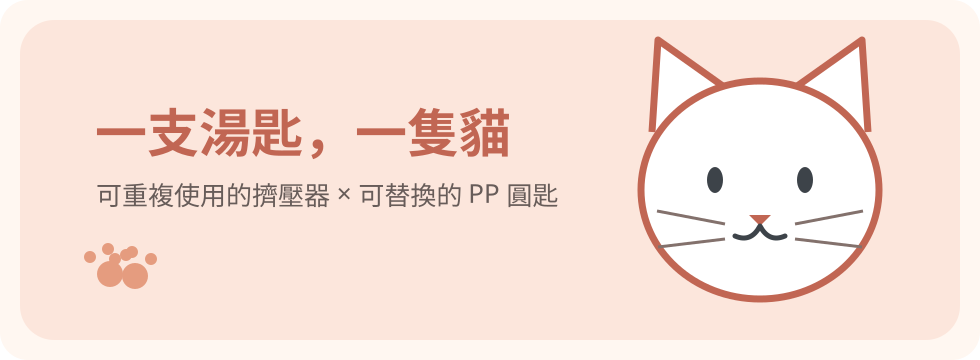

# 🐾 喵～一起吃貓條！

**一支湯匙，一隻貓。可替換食匙的 3D 列印貓條餵食器。**

> 專案連結：[github.com/hun186/cat-treat-feeder](https://github.com/hun186/cat-treat-feeder)  
> 目前版本：V1.14 工程原型，**尚未完成實體安全與食安驗收**。

## 為什麼要設計它？

餵貓條時可以用市售約 30 元的餵食器，也能列印完整一體式餵食頭。但不同貓群之間共享接觸嘴巴的前端，即使清洗後風險可能不高，衛生操作仍較仰賴現場確實消毒。本設計**保留可重複使用的擠壓本體，讓直接接觸肉泥和貓舌的部分，換成獨立準備的 PP 大圓匙**，更容易形成一貓一匙的 SOP。

## 三種做法，各有優缺點

| 方案 | 優點 | 侷限 |
|---|---|---|
| 商購約 NT$30 餵食器 | 便宜、現成、沒有列印門檻 | 多貓或跨場域共用接觸端，需確實清潔、適當消毒 |
| 自己列印整支含前端餵食頭 | 外形完全客製、無須另外固定湯匙 | 3D 列印食品接觸區的清潔、層紋、耗材與噴嘴熱端適用性須特別評估 |
| 本專案：列印本體＋替換 PP 食匙 | 前端可個別替換，減少列印件直接接觸貓條；餐廳常見圓匙也可能適用 | 要尺寸相符的湯匙、3D 列印／切片與裝配技能；新購免洗匙也增加廢棄物 |

## 湯匙：不是特殊品，也可能來自日常餐廳

範例是**PP 大圓匙**，非叉匙。長度約 155 mm、勺面約 43 × 50 mm，柄最窄約 9 mm、最寬約 14 mm、厚約 6 mm；距尾端最寬點 35 mm、最窄點 87 mm、匙頭交界 102 mm。這些是一般尺的估計值，**不同模具的同長度湯匙未必適配**。

- 新購範例：[蝦皮「大圓匙 大叉匙 100入/包…走道G」](https://shopee.tw/%E5%A4%A7%E5%9C%93%E5%8C%99-%E5%A4%A7%E5%8F%89%E5%8C%99-100%E5%85%A5-%E5%8C%85-%E5%A1%91%E8%86%A0%E6%B9%AF%E5%8C%99-%E5%85%8D%E6%B4%97%E9%A4%90%E5%85%B7-%E5%A1%91%E8%86%A0%E9%A4%90%E5%85%B7-%E7%94%9C%E5%93%81%E6%B9%AF%E5%8C%99-%E9%A4%90%E5%BB%9A%E7%94%A8%E5%93%81-%E5%9C%93%E5%8C%99-%E6%B9%AF%E5%8C%99-%E8%B5%B0%E9%81%93G-i.23853172.7164826243)（選「大圓匙」）；當前包數須自行確認，歷史包裝照片寫 50 PCS，商品標題寫 100入。
- **餐後留用**：有時餐廳會提供相似圓匙，用完後若完整無裂、尺寸吻合，可用洗碗精洗淨、沖淨、晾乾，保存作為某隻貓的乾淨食匙。清洗不等於消毒／無菌；跨貓群仍優先未用過的新匙並遵守場域規定。

## 衛生風險說明

貓咪之間的 FCV／FPV 等病原可透過污染器具間接傳播；接觸端個別替換，是降低一個途徑，不是絕對隔離。FCV 不會感染人，但人貓仍有其他共通病原，因此餐後留用也需清洗。共用本體與手部如遭污染，亦須清潔及適當消毒。

## 目前進度與取得模型

V1.14 已改善前端擋板列印切面，保留對稱滑軌、52 mm 夾持距離，並修正前端易鬆脫及卡扣根部強度。**CAD 幾何檢查不代表實際裝配或餵食安全測試通過。**

- [最新 CAD／STL 下載](../current/)
- [實測尺寸](measurements.md)
- [試印與組裝 SOP](printing-and-fit.md)
- [V1.0～V1.14 研發歷程](development-history.md)
- [湯匙採購及餐後再利用](spoon-sourcing-and-reuse.md)

**此 repo 公開可供下載，但目前沒有指定 LICENSE；授權條款確認前，請勿把公開檔案等同可任意再散布的授權。**
